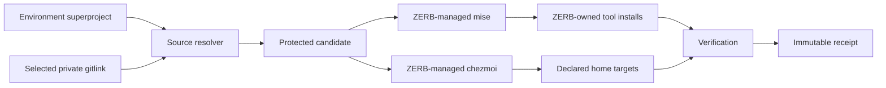

# Target Architecture

## Goals

ZERB MUST:

- Restore a selected, declared developer environment on a mutable Linux workstation.
- Compose public and private profile sources into one reviewable candidate.
- Delegate tool semantics to mise and dotfile semantics to chezmoi.
- Keep all ZERB-managed tool binaries, configuration, data, cache, and state separate from pre-existing installations.
- Resolve every selected Git source before host mutation.
- Make trust, conflicts, partial failure, and non-hermetic inputs visible.
- Refuse every unowned or user-modified existing target in the MVP; there is no overwrite approval or force path.
- Record what was applied and observed without pretending that the host changed atomically.

ZERB MUST NOT:

- Become a package manager or dotfile manager.
- Parse or generate an executable general-purpose configuration language.
- Search `PATH` for mise or chezmoi during managed operations.
- Supply, discover, read, execute, or write a user's existing mise or chezmoi state through its own orchestration code. Trusted candidate code (templates, backends, providers) runs with the user's full authority and may access normal user files; ZERB does not supply manager discovery paths or credentials to this code.
- Register a second mise activation hook in the user's current shell.
- Fetch every submodule recursively.
- Accept credentials in source URLs or command arguments.
- Claim that private Git metadata is hidden.
- Claim rollback where only resumable convergence exists.

## System boundary



ZERB owns resolution, composition, trust, orchestration, state transitions, and receipts. Native Git owns transport and repository semantics. Mise owns tool resolution and installation. Chezmoi owns source-to-target mapping, template rendering, target modes, application, and verification.

## Environment source model

### Superproject

An environment superproject contains:

- A versioned ZERB manifest.
- An embedded public `base` profile.
- Zero or more embedded public selectable profiles.
- Zero or more Git links to private selectable profile repositories.

A profile is selected by a stable logical ID from the manifest, not by accepting an arbitrary filesystem path at apply time.

MVP composition is exactly:

```text
base + selected
```

`personal` and `work` are alternatives in the MVP. There is no transitive inheritance, implicit profile stack, or machine-specific merge graph.

### Illustrative profile contents

```text
profile/
├── profile.toml        # ZERB metadata; no secret values
├── mise.toml           # native mise declarations
├── mise.lock           # native lock data when supported
└── home/               # native chezmoi source fragment
```

The formal OpenSpec proposal MUST define the manifest schema, versioning, path rules, source kinds, supported entry types, and forward-compatibility behavior. Unknown required fields or unsupported source object types fail closed.

### Provenance

An embedded profile is identified by:

- Superproject credential-free source ID.
- Superproject commit.
- Component path.
- Component tree digest.

A submodule profile is identified by:

- Superproject commit.
- Submodule logical ID and path.
- Credential-free effective locator.
- Gitlink commit object ID.
- Materialized tree digest.

A commit ID identifies content but does not guarantee that the server will continue serving it. Resolution reports identity and current availability separately.

### Source binding and candidate lifecycle

On an empty state root, source discovery is explicit: `profile list`, static inspection, and `plan` receive the superproject source argument. ZERB does not infer a source from the current directory or ambient Git remote.

`plan` produces an immutable planned candidate artifact. This artifact records the source objects, profile ID, materialized digest, adapter and policy versions, transport authorization, content trust decision, destination observations, and revalidation/expiry conditions. It records non-secret provider metadata only: provider identity, version, and generation token where the provider proves one; it never stores resolved provider values, host fact values, or rendered content.

Standalone `apply` consumes the explicit planned-candidate digest, transitions durable state to `prepared(A,B)` under the writer lock, and fails when the artifact is absent, ambiguous, stale, changed, or untrusted. `bootstrap` calls the same inspect, trust, plan, prepare, and apply path rather than maintaining separate implicit state.

After successful apply, the stable receipt binds the current source/profile/candidate for exact-candidate reapply and diagnosis. The MVP does not resolve a newer commit implicitly. Profiles with dynamic-unversioned provider outputs or host-fact-dependent templates are bootstrap-only; the MVP refuses exact-candidate reapply for such profiles because idempotence cannot be promised. Profiles with only static or versioned-provider inputs are exact-candidate reapplicable; a changed source, declaration, adapter version, policy, or provider generation token produces a different planned candidate and is an unsupported update.

## Native Git and private profiles

ZERB uses a pinned minimum native Git for object semantics and approved native authentication. The Git executable is resolved once from an approved system location, canonicalized, hashed/recorded, and then invoked by absolute path with argument arrays. ZERB never interpolates Git shell commands or writes global/system Git configuration.

Git and its transport helpers are execution boundaries distinct from candidate-content trust. Per-invocation policy MUST:

- Allowlist supported transports. MVP permits public unauthenticated HTTPS and explicitly authorized private HTTPS/SSH endpoints; it rejects `ext`, `file`, custom remote helpers, and unknown schemes.
- Clear inherited `GIT_*`, `SSH_*`, askpass, proxy, executable-lookup, config, object, hooks, pager, and editor controls except values explicitly reconstructed for the phase.
- Disable system/global/repository Git configuration for fetch/materialization, then inject only audited fixed policy and an explicitly approved authentication channel.
- Discover configured credential-helper/SSH mechanisms without executing them, reject shell-fragment or non-canonical helper identities, show the canonical mechanism and post-policy endpoint, and obtain transport authorization before any helper/agent/network invocation. Authentication-mechanism storage and side effects are outside ZERB's guarantee and are stated at approval.
- Neutralize hooks, init templates, attributes filters, custom update commands, URL rewrites, protocol overrides, and checkout behavior.
- Fetch into a protected bare/object store and materialize trees through no-checkout object plumbing. ZERB does not run worktree checkout filters or hooks.

Bootstrap behavior:

1. Fetch the public superproject over unauthenticated approved HTTPS with all credential channels disabled; an authentication challenge fails rather than invoking a helper.
2. Statically validate the manifest, `.gitmodules`, Git object types, paths, and locators.
3. Resolve the selected profile and its gitlink.
4. Display and authorize the effective credential-free private endpoint and canonical authentication mechanism.
5. Only then invoke the approved authentication channel and fetch the selected private repository's recorded commit into protected object storage.
6. Materialize only approved tree entries without checkout-time filters or hooks.
7. Reject nested submodules in profile content for the MVP.
8. Fetch every required object before host mutation.

ZERB rejects credential-bearing URLs. ZERB does not accept, copy, log, or persist authentication secrets. Authentication belongs to the user's explicitly approved Git/SSH mechanism; that mechanism's execution and credential-storage policy is outside ZERB's guarantee.

A public `.gitmodules` and superproject history expose submodule names, paths, URLs, gitlink commit IDs, and update timing. A private repository protects content through access control; it does not encrypt authorized local object storage. Metadata-hidden discovery and a protected local source registry are post-MVP; users who must hide profile identity are unsupported by the MVP gitlink topology.

## Process environment policy

Every external process receives an environment assembled for its phase rather than the ambient environment unchanged. The OpenSpec design MUST freeze a variable-by-variable policy for the pinned versions.

| Process | Working directory and home | Inherited channels | Cleared or replaced controls |
|---|---|---|---|
| Native Git fetch | Protected source root; real home only where an approved credential helper requires it | Minimal locale/terminal data plus approved SSH-agent or credential-helper channels | Unapproved `GIT_*`, arbitrary `PATH`, hooks, filters, helpers, pagers, editors, URL rewrites, and unsafe protocols |
| Binary acquisition/extraction | Fresh protected staging root and synthetic home | Network proxy/CA inputs explicitly approved for acquisition | Manager variables, profile variables, ambient secrets, arbitrary executable lookup |
| Mise resolution/install and descendants | Protected candidate root and synthetic ZERB-owned home/XDG roots | Explicit registry/provider channels required by an approved backend | All inherited mise/asdf/rtx controls, user config discovery, hooks/tasks, ambient shims, and ambient secrets |
| Chezmoi mapping/apply and template/provider descendants | Protected candidate root; explicit real destination; home/XDG policy defined per approved provider | Only approved host facts and provider channels after candidate trust | Existing chezmoi state, arbitrary control variables, ambient shims, pagers/editors, and unapproved helper execution |
| `zerb exec` payload or `zerb shell` | Real user home with ZERB-selected tool environment | User payload inputs defined by the command contract | Wrapper-owned manager controls are set explicitly; parent-process state cannot be mutated by the child |

The policy covers descendants, not only the first managed process. Separate markers prove the handling of authentication material, provider values, rendered values, and unrelated ambient secrets.

## Mise integration

### Ownership

Mise owns:

- Tool and backend semantics.
- Version resolution.
- Artifact acquisition and installation.
- Native lockfile semantics.
- Construction of command environments for installed tools.

ZERB owns:

- Profile selection and collision policy.
- Exact-version policy and backend allowlist.
- Isolation environment construction.
- Pinned mise binary acquisition and verification.
- Invocation ordering and failure journaling.
- Recording requested and observed resolutions.

Profile tool declarations remain native mise TOML. ZERB MUST NOT introduce a second general tool DSL. Before trust, ZERB statically enforces a versioned MVP allowlist of declaration sections, built-in backends, and non-executing options; tasks, hooks, sourced environment files, plugins, custom backends, and other execution-capable extensions fail. The proof phase must demonstrate a deterministic, isolated base/profile configuration hierarchy under the pinned mise release. Duplicate tool identities across `base` and `selected` fail rather than inheriting mise's normal override behavior.

Floating aliases such as `latest` are not accepted as the applied contract. A supported alias MAY be resolved only after digest-bound trust and only if its exact result is locked and becomes the value that apply consumes and records.

### Mise isolation contract

Every managed invocation and descendant MUST:

- Execute ZERB's verified mise binary by absolute path.
- Start from the phase-specific environment policy, including a sanitized executable search path.
- Remove inherited mise, asdf, and rtx control variables before adding ZERB-controlled values.
- Set ZERB-owned home/XDG, data, config, cache, state, install, download, plugin, and shim paths supported by the pinned release.
- Redirect or suppress global and system configuration discovery.
- Bound local configuration discovery to the protected candidate hierarchy.
- Disable unintended environment-profile discovery, hooks, tasks, sourced environment, idiomatic version files, plugins, and auto-install behavior unless explicitly approved.
- Trust only the digest-approved candidate path and execution policy.
- Invoke explicit install, lock, inspect, and exec operations; never use settings commands that could write user configuration.
- Keep all ZERB-owned directories below protected roots and prevent backend descendants from falling back to user-manager state.

The pinned-version proof MUST verify the exact behavior of at least:

- `MISE_DATA_DIR`
- `MISE_CONFIG_DIR`
- `MISE_CACHE_DIR`
- `MISE_STATE_DIR`
- `MISE_INSTALLS_DIR`
- `MISE_DOWNLOADS_DIR`
- `MISE_PLUGINS_DIR`
- `MISE_SHIMS_DIR`
- Global and system config-file overrides
- Config filename and ceiling-path controls
- Hook, auto-environment, and auto-install controls

Environment variables are versioned upstream interfaces. The roadmap does not authorize assuming that an untested future mise release preserves them.

### Shell boundary

ZERB MUST NOT run `mise activate` in the user's current shell. A pre-existing mise activation and a ZERB activation would compete for hooks and `PATH` state.

The MVP exposes:

- `zerb exec -- <command>` for command-scoped execution using the selected profile.
- `zerb shell` for a clean child shell whose startup and wrapper environment are owned by ZERB.

The child shell does not source the user's normal interactive startup files by default because those files may activate the user's mise installation. An explicit future opt-in MAY inherit selected shell configuration after coexistence is proven. ZERB never edits shell startup files automatically in the MVP.

ZERB guarantees that its wrapper does not mutate the parent process environment, automatically edit startup files, or persist its temporary `PATH`/manager controls after the child exits. Commands launched through `zerb exec` and actions performed in `zerb shell` have normal user authority and may intentionally change user files; their arbitrary effects are outside the no-interference guarantee.

## Chezmoi integration

### Ownership

Chezmoi owns:

- Native source attributes and source-to-target mapping.
- Template rendering.
- Target modes.
- Managed-target enumeration.
- Diff, apply, and verify behavior.

ZERB owns:

- Pinned chezmoi binary acquisition and verification.
- Source-fragment composition and collision rejection.
- Generated runtime configuration and isolated paths.
- Trust before template evaluation.
- Destination conflict policy.
- Apply journaling and receipts.

### One effective source

ZERB materializes pinned `base` and `selected` `home/` trees from protected Git object storage into a fresh protected candidate. It preserves supported path bytes, file bytes, and executable modes and does not rewrite authored chezmoi filenames or template contents.

MVP rules:

- Duplicate raw source paths fail.
- Duplicate resolved destination targets fail.
- Overrides fail; there is no implicit last-writer-wins behavior.
- ZERB obtains target mappings from the pinned chezmoi implementation or a proven machine-readable interface; it does not decode chezmoi filename attributes.
- Actual filesystem symlinks and unsupported Git object types fail until safe extraction is specified.
- A versioned pre-trust allowlist contains ordinary target entries, target templates, and explicitly named passive data/template controls.
- `run_*` scripts, externals, authored removal directives, `.chezmoiroot`, source configuration templates, and other direct mutation controls are deferred.
- Template evaluation occurs only after digest-bound trust. Allowed templates are trusted code. The MVP allowlist restricts template functions to three classes: (a) deterministic data-only functions (exact-candidate reapply permitted), (b) explicitly approved provider-specific lookup functions classified as versioned (result bound by provider generation token; reapply permitted) or dynamic (result depends on runtime state; bootstrap-only), and (c) explicitly approved host-fact functions (OS, environment, hostname, user data — always bootstrap-only). Arbitrary `output`, `run`, `command`, and filesystem-access template functions are excluded from the MVP.
- Named template and passive-global-file behavior is allowed only after its exact semantics and collision behavior pass the proof gate.
- ZERB reserves its generated runtime configuration and any future generated cleanup controls.

Sequential application of independent sources is prohibited.

### Chezmoi isolation contract

Every managed invocation MUST execute ZERB's chezmoi binary by absolute path and pass explicit protected values for:

- `--source`
- `--config`
- `--cache`
- `--persistent-state`
- `--working-tree` when relevant
- `--destination`

ZERB uses an owned runtime configuration and does not run chezmoi `init`, `update`, auto-commit, or auto-push against profile repositories. Post-trust structural operations use noninteractive, no-pager, no-color, conflict-error, and secret-skipping modes where supported.

The destination is intentionally the user's real home directory for an apply. That destination is an unavoidable shared surface. ZERB can isolate chezmoi's binary and state, but it cannot detect or exclude every non-cooperating process that writes the same targets.

Therefore:

- Existing chezmoi source, config, cache, persistent state, and working tree are never read, executed, or written by ZERB's own orchestration code.
- A pre-existing target not proven from the stable ZERB receipt is a non-overridable conflict.
- Foreign ownership can be reported only from supplied or observable evidence; ZERB does not claim a global ownership registry.
- The writer lock excludes only cooperating ZERB processes, not another chezmoi instance or arbitrary home writer.
- Apply performs no-follow validation of every ancestor directory and the final target entry (`lstat`, owner, type, link-count, content) before and after target mutation. Symlinked, renamed, or substituted ancestor components are rejected; the target must be reached through an unbroken chain of non-symlink directories owned by the expected principal.
- An observed file, symlink, hardlink, type, or content race prevents `stable` completion and leaves a truthful dirty journal.
- User-modified managed targets are never overwritten silently.
- Automatic old-only removal is deferred until a quarantine and recovery design is proven.

The non-interference guarantee covers ZERB's orchestration code: it does not discover, supply, read, execute, or write pre-existing manager state paths. Trusted candidate code (templates, backends, providers) runs with the user's full authority and can access normal user files; ZERB does not supply manager discovery paths or credentials to this code, and the MVP template function allowlist excludes arbitrary filesystem access. Trusted candidate code accessing manager state through normal user-level discovery is outside the no-interference contract.

## Planning and trust boundaries

### Static source inspection

Pinned managed-adapter acquisition is ZERB-controlled input acquisition, occurs before semantic planning, and does not trust candidate content. Pre-trust candidate work is otherwise limited to constrained public fetch, transport-authorized private authentication/fetch, object parsing, manifest/allowlist validation, endpoint disclosure, and canonical digest construction. It does not invoke candidate-selected mise backends/plugins/tasks/hooks, evaluate chezmoi templates, start providers, read profile-selected host files, or mutate the destination/declared-tool store.

Native authentication may execute a user-approved credential helper, SSH client/config, or agent before candidate-content trust. That separate transport trust channel is disclosed and governed by the Git policy.

### Digest-bound trust

Approval binds the candidate source digest, exact Git/mise/chezmoi versions, declaration/template allowlists, provider policy, and subprocess environment policy. Any change invalidates approval.

### Post-trust structural plan

A structural plan MAY write protected candidate/cache state and execute only approved manager inspection or non-value provider-readiness paths after candidate trust, but it does not mutate destination files or declared-tool installations. It records:

- Selected source identities and exact Git objects.
- Unsupported or dangerous source controls.
- Raw-source and resolved-target collisions.
- Requested tools and exact/locked resolutions where available.
- Existing destination path classifications without displaying secret-bearing file contents.
- Expected mutation phases and non-hermetic dimensions.

Selected profiles are trusted configuration and potentially trusted code. Templates, tool installers, package backends, providers, and approved helpers can execute or obtain code after trust. The roadmap does not describe them as sandboxed.

Sensitive content diffs are deferred until a separately approved design defines explicit terminal-only output exceptions and proves no log, receipt, or diagnostic capture occurs.

## Secrets

ZERB stores provider references and logical identifiers, never resolved secret values. It delegates retrieval to approved native chezmoi or mise provider facilities where possible.

Resolved values MUST NOT enter ZERB-owned repositories, manifests, lockfiles, candidate/materialized sources, non-secret runtime configuration, argv, output, logs, journals, receipts, exported diagnostics, or temporary/cache locations. An approved provider may use only its documented protected provider-owned ephemeral storage, and the intended destination file may contain a rendered secret by design.

Provider-owned credential storage, native Git/SSH credential storage, and an invoked user command's behavior are outside ZERB's storage guarantee. ZERB still MUST NOT accept, copy, print, log, or persist their values.

Separate authentication, provider, rendered-destination, and ambient-secret markers verify each boundary. Intended secret destinations and any approved provider storage must receive restrictive ownership and permissions at creation, not only after completion.

Private profile repositories are not secret stores. Whole-file age encryption is deferred until key bootstrap and recovery are specified.

## Protected storage and managed binaries

ZERB creates private source, candidate, toolchain, journal, receipt, and secret-adjacent roots with restrictive modes independent of the caller's umask. It rejects symlinked, hardlinked, wrong-owner, or group/world-writable path components; uses no-follow opens; stages on the same protected filesystem; and atomically promotes verified content where supported. Interruption cannot expose a broader-permission temporary file.

Managed binary archives are authenticated and fully hashed before parsing. Extraction occurs in a fresh protected root and rejects absolute paths, traversal, aliases, duplicate entries, symlinks/hardlinks, devices, and unsupported types. ZERB verifies the expected executable identity after extraction, atomically promotes it, confines cleanup to the staging root, and treats a poisoned or partial cache as invalid.

## Transition state

Host mutation is not atomic. The durable state model is:

```text
stable/current(A)
  -> prepared(A, B)
  -> mutating(A, B, phase)
  -> stable/current(B)                  on one atomic stable commit
  -> dirty(A, B, phase, journal)        on any abnormal exit after mutating
```

`A` is the prior stable candidate or the explicit empty baseline on first bootstrap.

Rules:

- One exclusive writer lock coordinates ZERB processes only.
- Candidate B and its journal are durable before mutation.
- `mutating` is persisted immediately before calling the first operation that may mutate; every abnormal exit from then until the stable commit is dirty.
- Receipt B is fully written and synced as pending before the stable commit. It is not completed merely because its file exists.
- One atomic durable `stable/current` record both references B and declares `stable(B)`. Only that reference makes receipt B completed.
- After the point of possible mutation, startup accepts only `{current=A, dirty(A,B,...)}` or `{current=B, stable(B)}`. A pending unreferenced receipt is orphaned evidence, not current truth.
- Startup reconciles stale journal cleanup without exposing crossed current/state claims.
- The previous receipt remains “last completed,” not a claim that a dirty host still matches it.
- While mutating or dirty, `bootstrap`, `plan` that would replace the candidate, `apply`, `exec`, and `shell` fail closed. `doctor` and approved recovery remain available.
- `recover resume` revalidates source objects, candidate/policy digest, destination observations, provider/tool preconditions, and completed phase outputs before replaying a supported forward phase.
- `recover repair` diagnoses and performs only an approved forward-convergence repair; it does not claim rollback.
- No MVP recovery path requires manual journal editing or relabels an unverified host as stable. Abandonment is post-MVP unless a later design defines a truthful unmanaged-dirty state.

Within a fresh apply, required tool installation is an additive phase into ZERB-owned storage and precedes dotfile apply. Missing provider declarations and readiness failures detectable without value retrieval fail before `mutating`. A provider retrieval or render failure that cannot be preflighted may occur during home apply and leaves `dirty` at that exact phase. The stable/current commit occurs only after tool verification, chezmoi apply, destination verification, required shell-environment generation, and pending receipt persistence all succeed.

For an existing stable installation, the MVP permits exact-candidate reapply only for profiles with static or versioned-provider inputs and no host-fact-dependent templates. Before `prepared`, candidate B must match A's source objects, profile ID, declarations, tool set, target set, adapter/policy versions, provider generation tokens, and canonical digest. Profiles with dynamic unversioned provider outputs or host-fact-dependent templates are bootstrap-only and refuse reapply. Any other change is an unsupported update and fails before mutation; ZERB does not apply a non-shrinking subset and call it convergence.

## Receipts and repeatability

A versioned protected receipt records:

- Logical source IDs and credential-free locators.
- Parent commit and embedded component path/tree digest.
- Submodule path and gitlink commit when applicable.
- Canonical candidate-tree digest including paths, entry types, modes, and contents.
- ZERB, Git, mise, and chezmoi versions.
- Manifest and runtime-config schema versions.
- OS and architecture.
- Authored tool requests, backend identities, resolved versions, effective lock content or durable reference, and available integrity facts.
- Managed target inventory.
- Completed mutation phases and post-apply observations.

Receipts live below a `0700` directory and use `0600` files. Public diagnostics redact sensitive source, target, provider, and employer metadata.

Repeatability is reported in independent dimensions:

- Inputs pinned.
- Artifact integrity pinned.
- Artifact currently available.
- Host compatible.
- Convergence verified.

The result is best described as pinned inputs and observed convergence on a mutable host, not a reproducible build.

## Primary upstream references

- [mise configuration](https://mise.jdx.dev/configuration.html)
- [mise settings](https://mise.jdx.dev/configuration/settings.html)
- [mise exec](https://mise.jdx.dev/cli/exec.html)
- [mise activate](https://mise.jdx.dev/cli/activate.html)
- [mise lockfiles](https://mise.jdx.dev/dev-tools/mise-lock.html)
- [chezmoi multiple-source design guidance](https://www.chezmoi.io/user-guide/frequently-asked-questions/design/#can-chezmoi-support-multiple-sources-or-multiple-source-states)
- [chezmoi global flags](https://www.chezmoi.io/reference/command-line-flags/global/)
- [chezmoi managed](https://www.chezmoi.io/reference/commands/managed/)
- [chezmoi verify](https://www.chezmoi.io/reference/commands/verify/)
- [Git submodule configuration](https://git-scm.com/docs/gitmodules)
- [Git credential interfaces](https://git-scm.com/docs/gitcredentials)
